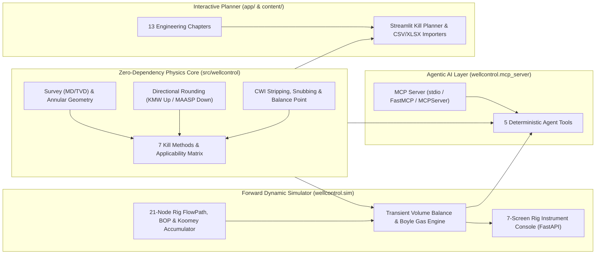

# wellcontrol

Deterministic well control & CWI (Completion and Well Intervention) physics engine, forward dynamic choke & BOP simulator, Model Context Protocol (MCP) agent server, and interactive kill planner covering vertical land wells, directional and horizontal wells, deepwater subsea wells, HPHT wells, and managed pressure / underbalanced operations.

Four parts that reference each other:

- **`src/wellcontrol/`** — a tested, zero-dependency Python calculation library (`dependencies = []`) covering hydrostatics, directional surveys, rheology, kick analysis, 7 kill methods, CWI stripping/snubbing, subsea choke line friction, HPHT, and MPD.
- **`src/wellcontrol/sim/`** — a real-time forward dynamic well control simulator and 7-screen rig instrument console (`Driller's Console`, `Choke Panel`, `BOP Remote Panel`, `Standpipe & Choke/Kill Manifolds`, `Wellbore Schematic`, `Latched Kill Sheet`, and `Graded Debrief`) served over FastAPI.
- **`src/wellcontrol/mcp_server.py`** — a built-in **Model Context Protocol (MCP) Server** exposing deterministic well control planning, CWI stripping/snubbing physics, and live simulator control to LLM agents so AI workflows never hallucinate safety-critical pressure math.
- **`app/` & `content/`** — a Streamlit kill planner and 13-chapter engineering textbook with worked examples verified against the solver.



## Install

```bash
python -m venv .venv
source .venv/bin/activate       # Linux / macOS (.venv\Scripts\activate on Windows)
pip install -e ".[dev,app,sim,mcp]"
pytest
```

- `[dev]` alone gives the core library and test suite with no third-party dependencies.
- `[app]` adds `matplotlib`, `streamlit`, `pandas`, and `openpyxl` for the kill planner.
- `[sim]` adds `fastapi`, `uvicorn`, and `httpx` for the 7-screen real-time choke simulator.
- `[mcp]` adds `mcp` for the Model Context Protocol agent server.

## Real-Time Choke & BOP Simulator (`wellcontrol.sim`)

While the kill planner is an *inverse* solver ("what drill pipe pressure should the driller hold?"), `wellcontrol.sim` is a *forward* dynamic model ("the student set the choke to 35% and the pump to 30 SPM — what does the well do?"). Every failure mode—underbalance taking a secondary influx, over-pressuring the shoe into formation losses, pumping against a closed valve, running out of Koomey accumulator bottle pressure, or letting gas migrate in a shut-in well—emerges directly from the transient volume balance rather than scripted animations.

```bash
uvicorn wellcontrol.sim.api:app --reload --port 8000
```

Open `http://127.0.0.1:8000` (or double-click **`Launch Choke Panel.bat`** on Windows) to operate the 7-screen self-contained rig console:

1. **Driller's Console (`driller`)** — Standpipe pressure, SPM, pit gain, flow out, hookload (including buoyed string weight minus wellhead ejection force), trip tank, and stripping controls.
2. **Remote Choke Panel (`choke`)** — Four-dial instrument scan (Drill Pipe PSI, Casing PSI, Pump Strokes, Choke Position %) with realistic valve travel lag, pump ramp rates, and procedural audio toggle.
3. **BOP Stack & Remote Panel (`bop`)** — Realistic Cameron/Shaffer surface stack and deepwater subsea stack with dual control pods and hydraulic accumulator drawdowns.
4. **Standpipe & Choke/Kill Manifolds (`manifolds`)** — High-fidelity P&ID and manifold synoptics with API 6A flanged gate valves, triplex mud pumps, poor-boy MGS, agitated active pits, and calibrated trip tank.
5. **Wellbore & P&ID Schematic (`well`)** — Live fluid zones with Taylor gas bubble dynamics, casing cement sheath, drill bit nozzles, and formation stratigraphy.
6. **Kill Sheet (`sheet`)** — Built from the student's own latched shut-in readings (`SIDPP`, `SICP`, `pit gain`).
7. **Post-Run Debrief (`debrief`)** — Automated grading (`excellent`, `pass`, `marginal`, `fail`) against scenario limits for BHP excursions, additional influx taken, and peak shoe pressure.
8. **AI Intelligent Coach & Scoring** — Automated IADC/IWCF scoring (0–100, letter grade, category breakdowns, point deductions with physical justifications, strengths, and chronological timeline).
9. **Instructor Master Station (`/teacher`)** — Live multi-student grid dashboard, remote master freeze / whiteboard mode, dynamic fault injection (pump failure, choke plug, accumulator leak, mud weight drop), cohort gradebook export (JSON & RFC 4180 CSV), and flight-recorder telemetry replay scrubbing.
10. **Procedural Rig Audio Engine** — 100% offline Web Audio synthesis of triplex mud pump thumps, choke fluid/gas shearing hiss, BOP mechanical actuation clunks, and alarm sirens.
11. **Crew Resource Management (CRM) Mode (`/crew`)** — Multi-student collaborative team simulator supporting IADC WellSharp & IWCF Level 4 crew training. Distributes operational authority across dedicated rig-floor stations (Driller, Choke Operator, Toolpusher, Mud Engineer, Observer) with real-time WebSocket synchronization, role permission gating, tactical VHF intercom radio callouts, and live multi-user telemetry.
12. **Multi-Monitor Detachable Cockpit Suite** — One-click window detachment for physical dual/triple-monitor simulator setups. Pop out individual workstations (Remote Choke, Driller's Doghouse, Manifolds P&ID, BOP Stack, Wellbore Schematic, EDR Trends) or launch an auto-tiled 3-screen rig suite with sub-millisecond cross-window state synchronization via `BroadcastChannel`.
13. **Visual Scenario & Custom Well Program Builder** — Graphical curriculum designer in `/teacher` allowing instructors to define custom casing depths, shoe fracture gradients (LOT), mud programs, initial shut-in pressures (SIDPP/SICP), and scripted in-flight faults (choke plug/washout, pump breakdown, accumulator leak) saved to disk and instantly deployed to trainees.
14. **Oil-Based Mud (OBM) Gas Solubility & Flash Breakout Engine** — Downhole PVT methane dissolution model in hydrocarbon base oil. Conceals influx downhole with only ~12% liquid swelling volume and near-zero pit gain, followed by rapid, violent methane breakout above the bubble point (1,500 psia) as gas flashes out of solution near surface.
15. **Customizable EDR Trend Recorder Workstation (`edr`)** — Electronic Drilling Recorder (Pason / NOV Totco / RigSense style) with driller-customizable multi-pen trend lines. Trainees can toggle active channels (SPP, SICP, SPM, Pit Gain, Differential Flow $\Delta\text{Flow}$, Flow In/Out, Hookload, Trip Tank, Choke %, BHP, Shoe Pressure), switch between Multi-Pen Overlay and Split-Track EDR modes, configure time zoom spans (1m, 5m, 15m, 30m, Full Run), inspect historical telemetry with interactive crosshair cursor scrubbing, review window min/max/average statistics, export RFC 4180 telemetry CSVs, and detach into a dedicated multi-monitor station.

## Model Context Protocol (MCP) Server for AI Agents

LLMs are notoriously unreliable at oilfield unit conversions, minimum-curvature TVD integration, and directional rounding. `wellcontrol.mcp_server` exposes 5 deterministic tools over stdio so AI agents (Claude Desktop, Cursor, OpenAI Agents SDK, LangGraph) can plan well kills, evaluate CWI stripping/snubbing operations, and fly the simulator:

```bash
python -m wellcontrol.mcp_server
```

| MCP Tool | Description |
| --- | --- |
| `evaluate_kill_methods` | Evaluates all 7 methods (`drillers`, `wait_and_weight`, `volumetric`, `stripping`, `lube_and_bleed`, `reverse`, `bullhead`) across any BOP × trajectory configuration; returns KMW, MAASP, usable/blocked verdicts, and peak shoe margins. |
| `plan_well_kill` | Generates a complete `KillPlan`, stage-by-stage procedure, drill pipe step-down schedule segments (flagging horizontal lateral pressure reversals), and optional two-phase `strip_then_kill` sequences. |
| `plan_stripping_and_snubbing` | CWI calculator for stripping/snubbing pipe through closed BOPs: computes upward wellhead force, buoyed pipe weight, exact balance point (`balance_point_md_ft`), closed-end vs. open-end displacement, gas migration bleed allowance, surge pressure, and missed-bleed pressure spikes. |
| `simulator_list_scenarios` | Lists all 10 built-in training scenarios (`drillers`, `find_the_kick`, `volumetric`, `lube_and_bleed`, `stripping`, `reverse`, `subsea`, `horizontal`, `weak_shoe`, `choke_plugs`). |
| `simulator_create_or_step` | Creates or advances a live `Session`, operating the choke, pump, stripping drawworks, and manifold valves, and returns rig gauges, kill sheet, and graded debriefs. |

## The kill planner

```bash
streamlit run app/streamlit_app.py
```

Or double-click **`Launch Kill Planner.bat`**, which builds the environment on
first run and binds to localhost only.

Two pages:

- **Kill Planner** — select one of four well configurations and one of seven
  kill methods. The app builds the geometry, plans the kill, and shows the
  step-by-step procedure with diagnostic plots: circulating pressures, pressure
  at the casing shoe against the fracture limit, influx volume, influx position,
  and bit depth while stripping. Each plan links through to the chapter
  explaining its method.
- **Learn** — the `content/` chapters rendered in the app, with a contents list
  and prev/next navigation.

### Importing real geometry

The planner accepts a **directional survey** and a **pipe tally** as CSV or
Excel, replacing the idealised geometry. TVD then comes from the actual
trajectory (minimum curvature) and string volume from the actual components —
which is what kill mud weight and strokes to bit are built on.

```python
from wellcontrol.importers import import_survey, import_tally

survey = import_survey("samples/survey_horizontal.csv").survey
tally = import_tally("samples/pipe_tally.csv").components
```

Working examples of both formats, and the accepted column headings, are in
[`samples/`](samples/README.md).

Combinations that cannot work say so. Volumetric and Lube-and-Bleed both depend
on gas migrating upward, and gas in a horizontal lateral does not migrate, so
those are reported as blocked rather than producing numbers for a procedure that
would stall on the rig.

```python
from wellcontrol import examples, plan_kill
from wellcontrol.wellconfig import WellConfiguration, BOPLocation, Trajectory

well = examples.well_state(
    WellConfiguration(BOPLocation.SUBSEA, Trajectory.HORIZONTAL))

plan = plan_kill(well, "wait_and_weight")
print(plan.format_summary())
print(plan.peak_shoe_pressure_psi, "psi at the shoe")
```

## Five minutes in

```python
from wellcontrol import examples

sheet = examples.vertical_land_well_kill_sheet()

for key, value in sheet.summary().items():
    print(f"{key:.<40} {value}")

print()
print(sheet.format_schedule(sheet.schedule_by_depth(steps=10)))
```

Abridged output:

```
Original mud weight (ppg)............... 9.6
Kill mud weight, calculated (ppg)....... 10.369
Kill mud weight, as mixed (ppg)......... 10.4
Formation pressure (psi)................ 5392
ICP (psi)............................... 1000
FCP (psi)............................... 650
Pressure per step, 10 steps (psi)....... 35
Strokes to bit.......................... 1466
Total strokes........................... 5483
```

Rounding in well control is **directional** — every rule goes the way that adds
margin. Kill mud weight rounds up, limits like MAASP round down, strokes round
up. See [the rounding rules](content/05-kill-sheet.md#rounding-is-directional).

## What is covered

| Module | Covers |
| --- | --- |
| `units` | Oilfield unit constants and conversions |
| `rounding` | Directional rounding rules — up for targets, down for limits |
| `survey` | MD/TVD conversion, build-and-hold trajectories |
| `geometry` | Capacities, annular volumes, drill strings, pump output |
| `hydrostatics` | Hydrostatic pressure, ECD, tripping, slugs |
| `rheology` | Bingham plastic and power law friction losses |
| `kick` | Shut-in analysis, influx identification, gas expansion |
| `killsheet` | Kill mud weight, ICP/FCP, pressure schedules, both methods |
| `tolerance` | Leak-off tests, MAASP, kick tolerance |
| `subsea` | Choke line friction, riser margin, subsea corrections |
| `hpht` | PVT density correction, temperature profiles |
| `mpd` | Surface backpressure, drilling windows, connection schedules |
| `wellconfig` | Well configurations: BOP location × trajectory |
| `stripping` | Stripping and snubbing: bleed volumes, balance point, surge |
| `content` | Reads the teaching chapters for rendering in an app |
| `importers` | Reads real directional surveys and pipe tallies from CSV |
| `methods` | Seven kill methods with per-configuration applicability |
| `plotting` | Diagnostic kill plots (matplotlib) |
| `sim` | Forward dynamic choke & BOP simulator, 10 scenarios, FastAPI server |
| `mcp_server` | Model Context Protocol (MCP) server for deterministic AI agents |

## Kill methods

| Method | Circulates? | Used when |
| --- | --- | --- |
| Driller's Method | Yes, twice | Standard. Start immediately, weight up later. |
| Wait and Weight | Yes, once | Standard. Weight up first, one circulation. |
| Volumetric Method | No | Cannot circulate; gas migrating. |
| Stripping to Bottom | No | Bit off bottom. Restores the circulation path. |
| Lube and Bleed | No | Cannot circulate; gas already at surface. |
| Reverse Circulation | Yes, backwards | Keeping the influx away from the casing shoe. |
| Bullheading | No | Cannot, or must not, bring the influx up. |

Each is planned against any of four configurations — Surface/Subsea BOP ×
Vertical/Horizontal. See [Choosing a kill method](content/12-choosing-a-kill-method.md)
for the applicability matrix and why two cells are empty.

## Content

Read in order, or jump to the well type you are working on.

1. [Fundamentals](content/01-fundamentals.md)
2. [Hydrostatic pressure](content/02-hydrostatics.md)
3. [Wellbore volumes and strokes](content/03-volumes-and-strokes.md)
4. [Kick detection and shut-in](content/04-kick-detection.md)
5. [The kill sheet](content/05-kill-sheet.md)
6. [Circulation methods](content/06-circulation-methods.md)
7. [Kick tolerance and MAASP](content/07-kick-tolerance.md)
8. [Directional and horizontal wells](content/08-directional-wells.md)
9. [Subsea wells](content/09-subsea-wells.md)
10. [HPHT wells](content/10-hpht-wells.md)
11. [MPD and underbalanced drilling](content/11-mpd-and-ubd.md)
12. [Choosing a kill method](content/12-choosing-a-kill-method.md)
13. [Stripping and snubbing](content/13-stripping.md)

## Reference wells

Three wells run through the tests and the content, chosen because they fail in
different ways:

| Well | Depth | Why it is here |
| --- | --- | --- |
| Vertical land | 10,000 ft MD/TVD | The textbook case where every simple formula works |
| Horizontal | 12,000 ft MD / 5,910 ft TVD | Anywhere MD and TVD are confused, this well gives a badly wrong answer |
| Deepwater subsea | 15,000 ft TVD in 5,000 ft of water | Choke line friction and riser margin dominate |

```python
from wellcontrol import examples

annulus, survey = examples.horizontal_well()
sheet = examples.horizontal_well_kill_sheet()
```

## A note on the constant 0.052

Every gradient in this library uses the field-standard rounded constant:

```
gradient (psi/ft) = 0.052 × mud weight (ppg)
```

The unrounded value is 1/19.25 = 0.051948. The gradient functions accept
`exact=True` if you want it, but 0.052 is what appears on every kill sheet and
every exam, and the 0.1% difference is far smaller than the uncertainty in the
mud weight itself.

## Scope and limits

- Friction correlations are approximations. Where a **measured** slow
  circulating rate pressure exists, use it in preference to anything computed
  here.
- Gas is treated as ideal and isothermal unless you supply temperatures and
  z-factors. This slightly over-estimates expansion, which errs toward caution
  for kick tolerance.
- HPHT density uses a linear PVT model with representative coefficients.
  Real HPHT work needs lab-measured PVT data for the actual mud.

**These are engineering aids, not a substitute for certification, a company
well control manual, or the judgement of a competent person on the rig.**
Verify against your own procedures before using any of it operationally.

## License

MIT
